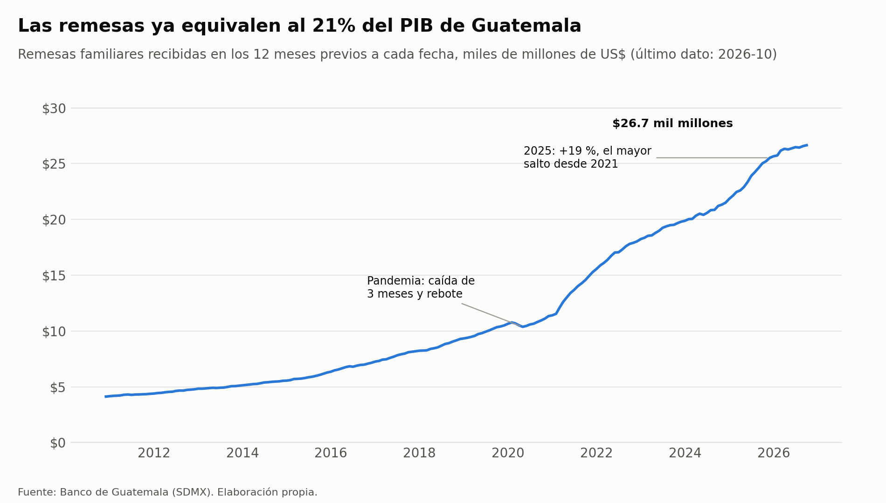
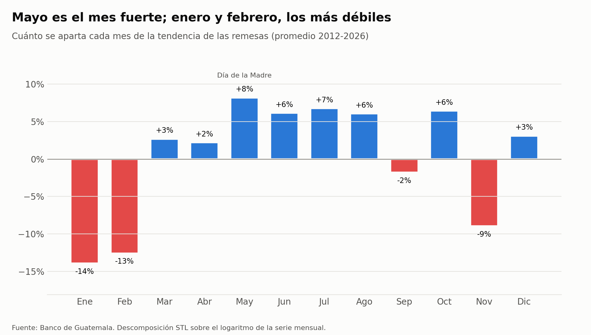
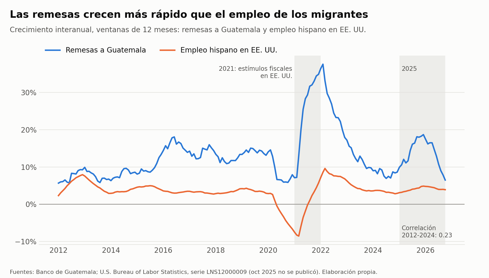
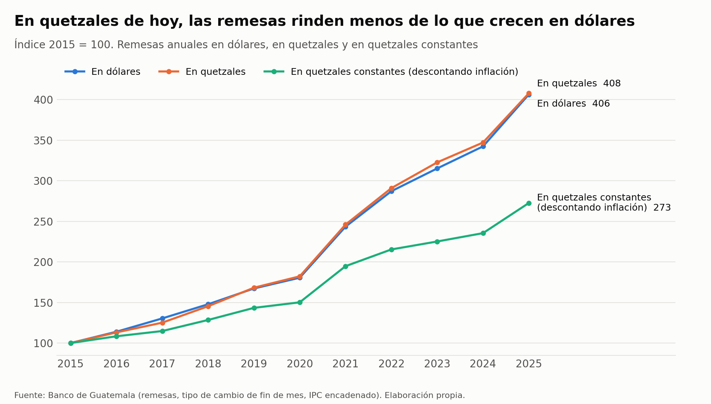
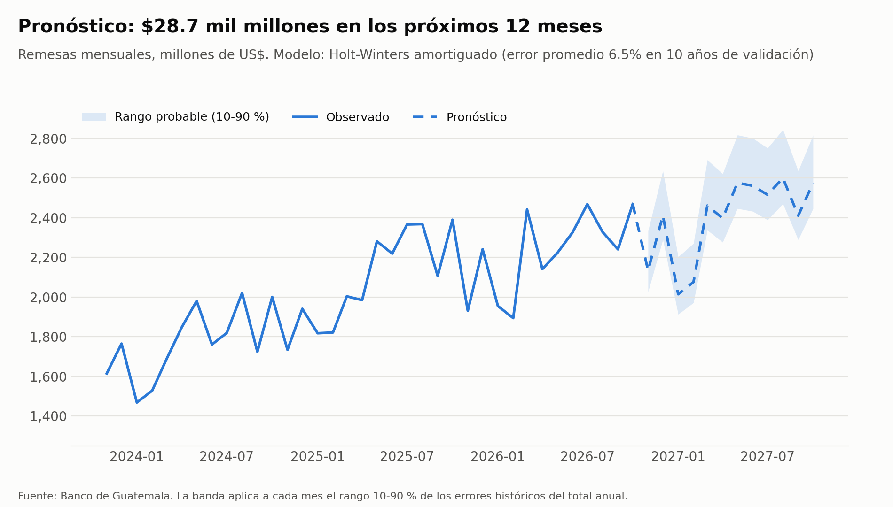
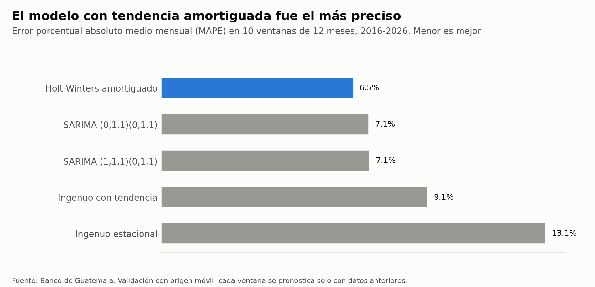

# Remesas a Guatemala: tamaño, estacionalidad y pronóstico

Las remesas familiares son la principal fuente de divisas de Guatemala. Este proyecto mide cuánto pesan en la economía, cómo se comportan a lo largo del año, qué tan ligadas están al empleo de los migrantes en EE. UU. y cuánto se espera recibir en los próximos 12 meses.

**Los datos se actualizan solos:** un flujo de GitHub Actions descarga los datos de Banguat y BLS dos veces al mes y regenera los cálculos y las gráficas.

**Herramientas:** Python (pandas, statsmodels, matplotlib) · SDMX · APIs públicas · GitHub Actions

## Hallazgos principales

### 1. Las remesas equivalen al 21 % del PIB


- En 2025 Guatemala recibió **US$25,530 millones**, cuatro veces lo de 2015 (US$6,285 millones).
- Su peso pasó de **10 % del PIB en 2015 a 21 % en 2025**, y equivalen al 24 % de todo el consumo de los hogares.
- **2025 creció 18.7 %**, el mayor salto desde 2021. En 2026 el ritmo se moderó: de enero a octubre el crecimiento fue de 5.3 % frente al mismo periodo de 2025.

### 2. Mayo es el mes más fuerte; enero y febrero, los más débiles


- **Mayo** está 8 % arriba de la tendencia (Día de la Madre), y de junio a agosto se mantiene alrededor de +6 %.
- **Enero y febrero** caen 13-14 % por debajo de la tendencia, después de los envíos de diciembre.
- Esto importa para leer los datos: comparar mayo contra abril no dice nada. Hay que comparar contra el mismo mes del año anterior.

### 3. El empleo de los migrantes no explica por sí solo las remesas


- Las remesas crecen casi siempre **más rápido que el empleo hispano en EE. UU.** La correlación entre ambos crecimientos fue de **apenas 0.23** en 2012-2024.
- Hay dos momentos en que se despegan con fuerza. En **2021** coincidió con los estímulos fiscales de EE. UU. En **2025** las remesas crecieron 18 % mientras el empleo creció cerca de 5 %.
- Una hipótesis para 2025 es que hubo envíos preventivos ante cambios en la política migratoria de EE. UU. **Con estos datos no se puede probar.** Contrastarla requeriría datos del número de envíos y del monto promedio por envío.

### 4. En quetzales de hoy, las remesas rinden menos de lo que crecen en dólares


- **En dólares**, las remesas de 2025 son 4.1 veces las de 2015. **En quetzales constantes**, es decir, descontando la inflación de Guatemala, son 2.7 veces.
- El tipo de cambio casi no se movió (promedio de Q7.67 por dólar en 2015 y Q7.70 en 2025), así que la diferencia la explica la inflación acumulada, sobre todo el 9 % de 2022.

### 5. Pronóstico: alrededor de US$28,700 millones de noviembre 2026 a octubre 2027


- El pronóstico es **US$28,700 millones**, 7.8 % más que los 12 meses anteriores. El rango probable va de **US$27,400 a US$31,400 millones**, calculado con los percentiles 10-90 de los errores históricos del modelo.
- El modelo asume que el crecimiento se sigue frenando, de acuerdo con la desaceleración que se ve en 2026.

## Cómo se eligió el modelo



Comparé 5 modelos con **validación de origen móvil**. Para cada uno de 10 periodos de 12 meses (nov 2016 a oct 2026), cada modelo se entrena solo con los datos anteriores y pronostica los 12 meses siguientes.

| Modelo | Error mensual promedio (MAPE) | Error promedio del total anual | Peor error del total anual |
|---|---|---|---|
| **Holt-Winters con tendencia amortiguada** | **6.5 %** | **5.1 %** | **8.7 %** |
| SARIMA (0,1,1)(0,1,1)₁₂ | 7.1 % | 5.3 % | 17.1 % |
| SARIMA (1,1,1)(0,1,1)₁₂ | 7.1 % | 5.6 % | 15.8 % |
| Ingenuo con tendencia (mismo mes del año anterior × crecimiento reciente) | 9.1 % | 7.5 % | 20.4 % |
| Ingenuo estacional (mismo mes del año anterior) | 13.1 % | 12.3 % | 24.8 % |

- **Holt-Winters amortiguado** gana en las tres métricas. Lo más importante es que su peor año fue mucho menos malo que el de los SARIMA: estos extrapolan el crecimiento reciente completo, y fallaron más después de los saltos de 2021 y 2025.
- **Una sola ventana de prueba habría llevado a otra conclusión.** En la ventana más reciente, el ingenuo estacional le gana a SARIMA. Por eso la elección se hizo con 10 ventanas.
- **Ningún modelo anticipó los saltos de 2021 ni de 2025**, porque no venían de la historia de la serie. El pronóstico supone que no habrá otro choque parecido.

## Datos y método

| Dato | Fuente | Detalle |
|---|---|---|
| Remesas familiares (mensual, US$) | Banco de Guatemala, archivo SDMX `Remittances` | desde 2010 |
| Tipo de cambio (fin de mes) | Banco de Guatemala, SDMX `EXR` | para pasar a quetzales |
| Índice de precios al consumidor | Banco de Guatemala, SDMX `CPI` (datos del INE) | ver encadenamiento abajo |
| PIB y consumo privado (anual) | Banco de Guatemala, SDMX `NAG` | para el peso en la economía |
| Empleo hispano o latino en EE. UU. | U.S. Bureau of Labor Statistics, serie `LNS12000009` | miles de personas, ajustado por estacionalidad |

- **Encadenamiento del IPC:** el índice cambió de base dos veces. Uso la base dic 2010 hasta 2023, la base dic 2023 para 2024 y la base 2024 desde 2025, empalmando cada tramo con el anterior. Lo validé contra la inflación oficial: 4.18 % en 2023 y 9.24 % en 2022 coinciden. La serie con base dic 2023 se queda casi plana después de 2024 y no la uso para esos años.
- **Estacionalidad:** descomposición STL robusta sobre el logaritmo de la serie (2012 en adelante).
- **Crecimiento interanual:** suma de 12 meses para remesas y promedio de 12 meses para empleo, para comparar la misma ventana de tiempo.
- **Huecos en los datos:** BLS no publicó octubre 2025 por el cierre del gobierno de EE. UU.; el promedio de 12 meses tolera ese hueco.

**Detalles técnicos que costó descubrir:**
- Banguat marca algunos datos faltantes con `.` dentro del XML.
- La API v1 de BLS ignora los parámetros de años si se consulta por GET; hay que usar POST.
- Los sitios del INE, la SIB y Minfin bloquean las descargas automáticas. Banguat no, y su IPC trae los datos del INE.

## Estructura
```
src/sdmx.py        lector genérico de archivos SDMX de Banguat (reutilizable para otros conjuntos)
src/descargar.py   descarga y arma la tabla mensual
src/analisis.py    peso en la economía, estacionalidad, validación de modelos y pronóstico
src/graficas.py    figuras del reporte
src/actualizar.sh  corre todo el flujo
.github/workflows/ actualización automática (días 8 y 20 de cada mes)
data/raw/          descargas originales sin modificar
data/processed/    tablas limpias y resultados (mensual, anual, modelos, pronóstico, resumen.json)
```

## Cómo reproducir
```bash
python3 -m venv .venv && .venv/bin/pip install -r requirements.txt
src/actualizar.sh
```
